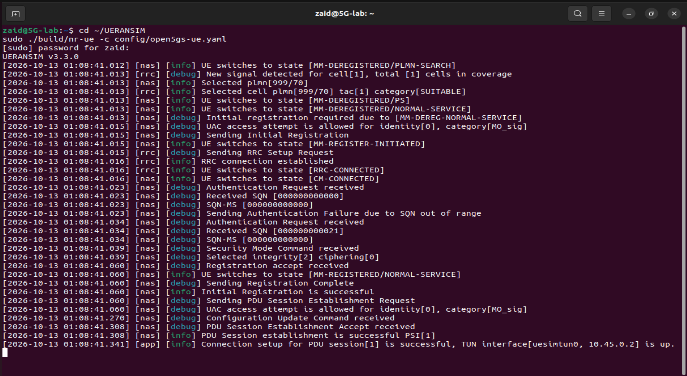
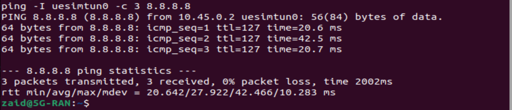
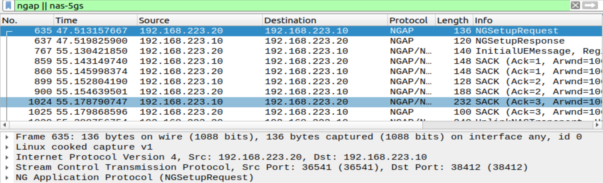

# Laboratoire 5G Standalone — Open5GS + UERANSIM

Déploiement d'un **réseau mobile 5G Standalone (SA) complet**, conforme 3GPP, émulé sur **deux machines virtuelles**, avec des outils **gratuits et open source**.

Le téléphone simulé s'inscrit sur le réseau, s'authentifie (5G-AKA), obtient une adresse IP et **navigue réellement sur Internet** à travers le cœur 5G.

> La couche radio est **émulée** (UERANSIM) : aucune onde n'est émise. Toute la signalisation (NAS, NGAP) et le plan utilisateur (GTP-U) sont en revanche réels et conformes aux normes 3GPP.

---

## Sommaire

1. [Objectif](#objectif)
2. [Architecture](#architecture)
3. [Environnement](#environnement)
4. [Installation](#installation)
5. [Démarrage du laboratoire](#démarrage-du-laboratoire)
6. [Résultats](#résultats)
7. [Analyse avec Wireshark](#analyse-avec-wireshark)
8. [Difficultés rencontrées](#difficultés-rencontrées)
9. [Compétences mobilisées](#compétences-mobilisées)
10. [Perspectives](#perspectives)

---

## Objectif

- Comprendre concrètement l'architecture d'un cœur 5G (5GC) et la séparation **plan de contrôle / plan utilisateur**
- Observer les procédures 3GPP : NG Setup, Registration, authentification 5G-AKA, Security Mode, session PDU
- Disposer d'une plateforme de test reproductible pour l'analyse protocolaire et l'expérimentation
- Le tout **sans matériel radio et sans budget**

---

## Architecture

```
           VM 5G-RAN (192.168.223.20)                     VM 5G-Lab (192.168.223.10)
  ┌───────────────────────────────────────┐      ┌──────────────────────────────────────────┐
  │                                       │  N2  │                                          │
  │  UE (nr-ue) ◄──radio──► gNB (nr-gnb) ─┼──────┼─► AMF ──► AUSF / UDM / UDR ──► MongoDB   │
  │  uesimtun0     simulée                │ NGAP │   :38412        (SBI)                     │
  │  10.45.0.2    127.0.0.1               │ SCTP │    │                                     │
  │                                       │      │    ▼                                     │
  │                          │            │  N3  │   SMF ──N4 / PFCP──► UPF                 │
  │                          └────────────┼──────┼─────────────────────► :2152              │
  │                                       │GTP-U │                        │                 │
  │            UERANSIM 3.3.0             │      │       Open5GS 2.8.0    ogstun 10.45.0.1  │
  └───────────────────────────────────────┘      └────────────────────────┼─────────────────┘
                                                                         │ N6 + NAT
                       Réseau virtuel VMware NAT (VMnet8)                 ▼
                       Passerelle 192.168.223.2                       Internet
```

| Élément | Rôle | Équivalent chez un opérateur |
|---|---|---|
| **UE** (UERANSIM `nr-ue`) | Téléphone simulé, avec sa SIM virtuelle | Le smartphone de l'abonné |
| **gNB** (UERANSIM `nr-gnb`) | Station de base 5G simulée | L'antenne sur le toit |
| **AMF** | Accès, enregistrement, mobilité | Porte d'entrée du réseau |
| **AUSF / UDM / UDR** | Authentification et données d'abonnés | Contrôle d'identité |
| **SMF** | Sessions de données, attribution d'adresse IP | Gestion des sessions |
| **UPF** | Transport du trafic utilisateur | Sortie vers Internet |
| **MongoDB** | Base des abonnés | Fichier clients |
| **WebUI** | Provisionnement des abonnés | Activation de la SIM en agence |

### Interfaces

| Interface | Entre | Protocole | Port |
|---|---|---|---|
| **N1** | UE ↔ AMF | NAS 5GS (transporté dans NGAP) | — |
| **N2** | gNB ↔ AMF | NGAP sur SCTP | 38412 |
| **N3** | gNB ↔ UPF | GTP-U sur UDP | 2152 |
| **N4** | SMF ↔ UPF | PFCP sur UDP | 8805 |
| **N6** | UPF ↔ Internet | IP + NAT | — |

### Plan d'adressage

| Élément | Adresse |
|---|---|
| VM 5G-Lab (cœur) | 192.168.223.10/24 (fixe) |
| VM 5G-RAN (accès radio) | 192.168.223.20/24 (fixe) |
| Passerelle VMware | 192.168.223.2 |
| Pool d'adresses des UE | 10.45.0.0/16 (passerelle `ogstun` 10.45.0.1) |

### Identité du réseau (valeurs de test)

| Paramètre | Valeur |
|---|---|
| MCC / MNC | 999 / 70 |
| TAC | 1 |
| Slice (S-NSSAI) | SST 1 |
| DNN | internet |
| IMSI de l'abonné de test | 999700000000001 |

---

## Environnement

| Composant | Version |
|---|---|
| Hyperviseur | VMware Workstation Pro (Windows) |
| Système invité | Ubuntu 22.04 LTS (2 VM) |
| Cœur 5G | Open5GS 2.8.0 |
| Base de données | MongoDB 8.0 |
| WebUI | Node.js 20 |
| Accès radio | UERANSIM 3.3.0 |
| Analyse | Wireshark 3.6, tcpdump |

Ressources : VM cœur 4 vCPU / 8 Go RAM, VM RAN 2-4 vCPU / 4 Go RAM.

---

## Installation

Le guide complet, étape par étape, est dans **[docs/installation.md](docs/installation.md)**.

En résumé :

1. **VM 5G-Lab** : MongoDB → Open5GS (PPA) → Node.js 20 → WebUI → création de l'abonné
2. **VM 5G-RAN** : clonage de la VM, compilation de UERANSIM, désactivation d'Open5GS
3. **Configuration réseau** : adresses fixes, AMF et UPF exposés sur l'adresse du cœur, gNB configuré vers le cœur
4. **Fiabilisation** : routage et NAT persistants, scripts de démarrage

Extraits de configuration : **[config/](config/)**.

---

## Démarrage du laboratoire

**VM 5G-Lab** : rien à faire, Open5GS, le routage et le NAT démarrent automatiquement.

**VM 5G-RAN** :

```bash
~/demarrer-5g.sh   # vérifie le cœur, lance gNB puis UE, teste l'accès Internet
~/arreter-5g.sh    # arrête proprement l'UE puis le gNB
```

Scripts : **[scripts/](scripts/)**.

---

## Résultats

| Test | Résultat |
|---|---|
| NG Setup gNB ↔ AMF | ✅ `NG Setup procedure is successful` |
| Enregistrement de l'UE (Registration + 5G-AKA) | ✅ `Initial Registration is successful` |
| Session PDU | ✅ adresse 10.45.0.2 attribuée, interface `uesimtun0` active |
| Ping vers Internet via l'UE | ✅ 0 % de perte, RTT ≈ 20 ms |
| Requête HTTPS via l'UE | ✅ réponse HTTP/2 200 |
| Redémarrage complet des deux VM | ✅ reprise automatique |

```bash
ping -I uesimtun0 -c 3 8.8.8.8
# 3 packets transmitted, 3 received, 0% packet loss
```

**Inscription du téléphone et session PDU**



**Accès Internet via l'UE**



---

## Analyse avec Wireshark

Capture sur la VM 5G-Lab (interface `any`), filtre :

```
ngap || nas-5gs || pfcp || gtp
```

Séquence observée :

| # | Message | Sens |
|---|---|---|
| 1 | PFCP Association Setup Request / Response | SMF ↔ UPF (au démarrage du cœur) |
| 2 | NGSetupRequest / NGSetupResponse | gNB ↔ AMF |
| 3 | InitialUEMessage, Registration request (SUCI) | UE → AMF |
| 4 | Authentication request / response (5G-AKA) | AMF ↔ UE |
| 5 | Security mode command / complete | AMF ↔ UE |
| 6 | Registration accept / complete | AMF ↔ UE |
| 7 | PDU session establishment request | UE → SMF (via AMF) |
| 8 | PFCP Session Establishment | SMF → UPF |
| 9 | PDUSessionResourceSetup + PDU session establishment accept | AMF → gNB / UE |
| 10 | GTP-U (ICMP encapsulé) | gNB ↔ UPF |

Observations notables :

- **Heartbeats PFCP** réguliers entre SMF et UPF : surveillance permanente du plan utilisateur
- **Reprise de l'association PFCP** : le SMF réessaie tant que l'UPF n'est pas prêt
- **Resynchronisation SQN** lors d'une authentification (protection contre le rejeu)
- **SUCI avec schéma NULL** et **NEA0** en laboratoire : identité et messages lisibles, alors qu'en production le SUCI est chiffré (Profile A/B) et le NAS chiffré (NEA1/NEA2)



Détails : **[docs/analyse-wireshark.md](docs/analyse-wireshark.md)**.

---

## Difficultés rencontrées

Le détail des diagnostics est dans **[docs/depannage.md](docs/depannage.md)**. Points principaux :

| Problème | Cause | Solution |
|---|---|---|
| Accès Internet bloqué avec tout sur une VM | Adresse de l'UE locale à l'hôte de l'UPF : paquets « martiens », boucle de routage, NAT contourné par conntrack | **Passage à une architecture à 2 VM** (RAN / Core) |
| `SCTP … Connection refused` | Espace manquant après `address:` dans `amf.yaml` (YAML strict) | Correction de la syntaxe |
| `Address already in use` côté gNB | Ancienne instance du gNB restée active | `pkill nr-gnb`, script d'arrêt |
| Adresse de la VM RAN changeante | DHCP VMware | Adresses fixes hors plage DHCP |
| Table de routage vide après redémarrage | NetworkManager désactivé (`nmcli networking`) | `nmcli networking on` |
| VM RAN injoignable | Carte réseau en mode Bridged | Passage en NAT |

---

## Compétences mobilisées

- Architecture 5G SA : 5GC, RAN, procédures 3GPP, interfaces N1/N2/N3/N4/N6
- Protocoles : NAS 5GS, NGAP, SCTP, GTP-U, PFCP, 5G-AKA
- Linux : administration, systemd, NetworkManager, routage, NAT, iptables
- Virtualisation : VMware, réseaux virtuels, clonage
- Diagnostic réseau : tcpdump, Wireshark
- Automatisation : scripts Bash

---

## Perspectives

- Tests multi-UE et mesures de débit (iperf3), vérification de l'UE-AMBR
- Scénarios d'échec : clé invalide, abonné non provisionné, PLMN incorrect
- Network slicing (plusieurs SST / UPF dédiés)
- UPF déporté sur une troisième VM (edge computing)
- Supervision Prometheus / Grafana
- Remplacement de UERANSIM par une radio SDR (srsRAN / OpenAirInterface) et des SIM programmables

---

## Références

- [Open5GS](https://open5gs.org/) — [documentation Quickstart](https://open5gs.org/open5gs/docs/guide/01-quickstart/)
- [UERANSIM](https://github.com/aligungr/UERANSIM)
- 3GPP TS 23.501 (architecture 5G), TS 24.501 (NAS 5GS), TS 38.413 (NGAP), TS 29.244 (PFCP), TS 33.501 (sécurité 5G)

---

*Projet personnel réalisé à des fins d'apprentissage, en environnement de laboratoire isolé. Les clés et identifiants présents sont les valeurs de test publiques fournies par Open5GS et UERANSIM.*
